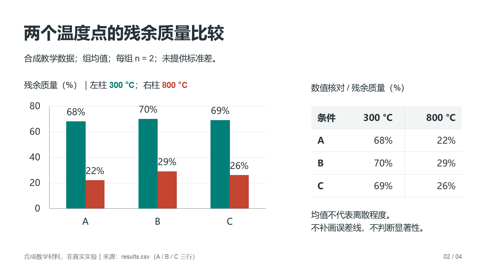
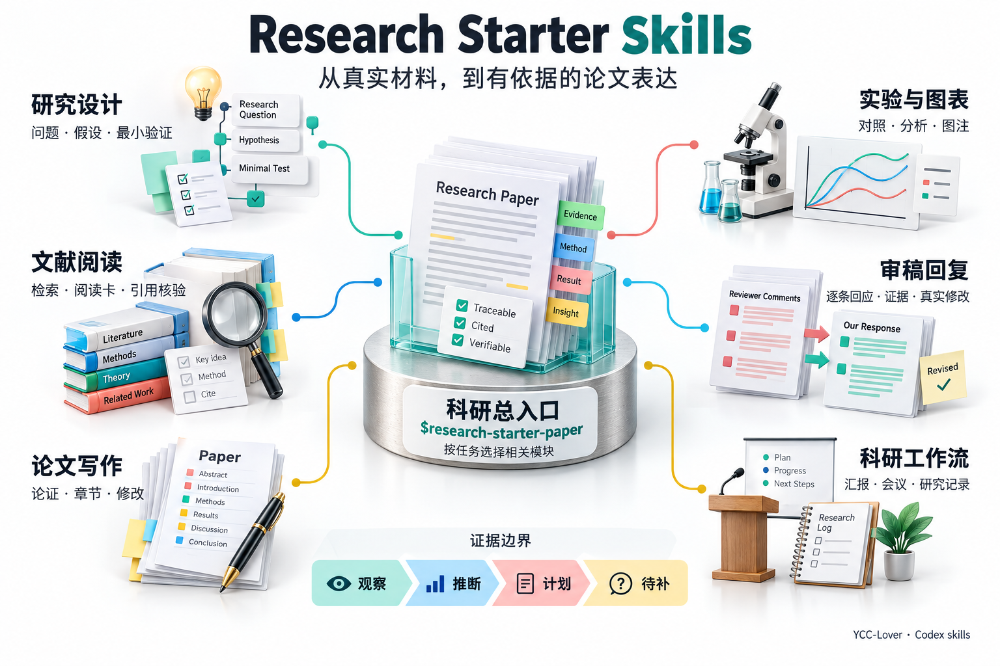

# Research Starter Skills

**科研入门、论文写作与学术汇报，连接到你正在做的研究。**

 

刚进课题组，缺少系统的科研训练或持续指导，不知道论文从哪里找、读完怎样形成问题、结果怎样写成论证？这里把科研方法整理为 **1 个总入口 + 6 个专业模块**，让 Codex 从你现有的一句话、一份笔记或一段草稿开始，陪你完成眼前的任务。

读 [Research-Starter-Kit](https://github.com/LAMDA-NeSy/Research-Starter-Kit) 的对应原创教程理解方法，再用本项目的 skills 处理自己的材料。从选题、检索与阅读，到自然润色、审稿返修、可编辑科研汇报和学术交流，按需要进入相应阶段。

**[三步开始](#quick-start) · [下载最新版](https://github.com/YCC-Lover/research-starter-skills/releases/latest) · [查看实际交付](#deliverables) · [文档导航](docs/README.md) · [English](README_EN.md)**

科研方法源于原项目的 19 篇教程；本仓库由 YCC-Lover 独立提炼、适配与扩展维护。[来源与致谢](#credits)

## 从你现在卡住的地方开始

| 你当前的问题 | 可以一起完成的成果 |
| --- | --- |
| 导师给了方向，但不知道下一步做什么 | 一张能带去组会的问题卡、最小材料请求与下一步行动 |
| 读了几篇论文，却写不出自己的观点 | 方法与证据对照、分歧梳理和有来源的综合段落 |
| 有结果和草稿，但论证不清、语言生硬 | 可替换正文、自然润色、作者语气匹配与章节联动清单 |
| 要返修、汇报或答辩，材料还很零散 | 有证据的回复、可编辑 PPTX、逐页讲稿与一问一答练习 |

没有完整计划也能起步。已有明确任务时，直接处理当前文本或文件；只想检查时，给出发现与建议，不自动改稿。

## 三步开始

### 1. 安装七个技能

在 [最新发布页](https://github.com/YCC-Lover/research-starter-skills/releases/latest) 下载 Assets 中的 `research-starter-skills-v<版本>.zip`，解压后在含 `catalog.json` 的目录运行：

~~~text
python scripts/install_skills.py
~~~

安装只需 Python 3.10+ 和标准库。七个目录一起安装到 `$CODEX_HOME/skills`，未设置时为 `~/.codex/skills`。普通文字指导无需安装绘图、演示或语音依赖。

使用 Git 安装，或更新已有安装

~~~text
git clone https://github.com/YCC-Lover/research-starter-skills.git
cd research-starter-skills
python scripts/install_skills.py
~~~

更新前先检查当前副本，保留需要的自定义内容，再指定备份目录：

~~~text
python scripts/install_skills.py --check
python scripts/install_skills.py --update --backup-dir <备份目录>
~~~

备份目录与来源、安装目录分开，按自己的存储约定选择。[完整安装与验收](docs/INSTALLATION.md)

### 2. 新开对话，带上一件材料

可以是一段草稿、一份笔记、一篇论文或一个可读的数据导出。没有文件也可以先说方向，不用先整理成专业模板。[零材料起步](docs/BEGINNER.md)

### 3. 说出想完成的事

~~~text
使用 $research-starter-paper。
我刚读研，没有系统学过科研。
导师让我看看【用自己的话写方向】，
带我做出下次组会能讨论的东西。
项目目录是【路径】，请在这里保存进度。
~~~

已有草稿、汇报材料或答辩任务？直接用这些请求

**修改与自然润色**

~~~text
使用 $rsk-paper-writing。
修改附件中的讨论，先给可替换正文。
保留数值、引用、研究含义和我的语气，
再列出关键修改与需要联动的章节。
~~~

**制作科研汇报**

~~~text
使用 $rsk-research-workflow。
根据附件笔记和数据制作8分钟组会PPT。
保留可编辑图表，附逐页讲稿，
说明证据不足之处，并检查实际导出文件。
~~~

**练习开题问答**

~~~text
使用 $rsk-research-workflow。
根据我的开题材料一次问一个问题，
等我回答后给针对性反馈，再继续追问。
~~~

[19 个任务提示词](examples/README.md) · [七套完整教学任务](examples/worked/README.md) · [原教程学习路径](docs/LEARNING_PATH.md)

## 看一份真实生成的交付

下面是 v2.1.0 四页合成教学汇报的实际 PowerPoint 渲染，展示其中的原生图表与表格。可以下载 PPTX，直接查看数据编辑、公式和讲稿。

**[下载可编辑示例 PPTX](https://github.com/YCC-Lover/research-starter-skills/releases/download/v2.1.0/research-presentation-demo-v2.1.0.pptx) · [查看输入与复做](examples/research-presentation/README.md) · [查看验收记录](evals/presentations-v21/REPORT.md)**

这份文件包含原生 Chart、Table、嵌入工作簿、OMML 公式和四页讲稿；另已验证只改封面时，其余三页及母版、布局、讲稿共 15 个部件字节不变。材料均为合成教学设定，不代表真实科研结果。[预览来源](docs/images/presentation-native.source.md)

## 总入口与六个模块

- **[科研总入口](skills/research-starter-paper/SKILL.md)**：不知从哪里开始、跨阶段任务、材料梳理与项目接续。
- **[研究设计](skills/rsk-research-design/SKILL.md)**：选题、比较候选问题、Idea 与最小验证。
- **[文献阅读](skills/rsk-literature/SKILL.md)**：检索、批判阅读、多文献综合、引用与版本核对。
- **[论文写作](skills/rsk-paper-writing/SKILL.md)**：章节论证、学位论文一致性、自然润色与作者语气。
- **[实验与图表](skills/rsk-experiments-figures/SKILL.md)**：公平比较、材料表征、图注与 TG/DTG 数据检查。
- **[审稿回复](skills/rsk-rebuttal/SKILL.md)**：逐条回复、返修排序、稿件与证据联动。
- **[科研工作流](skills/rsk-research-workflow/SKILL.md)**：可编辑 PPT、模板改稿、组会、参会与答辩演练。

查看总入口与六个模块的概念图

概念图由本项目使用 GPT-image 生成，不是软件界面或研究数据。[生成说明](docs/images/workflow-product.prompt.md) · [更多展示场景](examples/SHOWCASE.md)

## 从自学到写作

**方法和实践连在一起。** [学习路径](docs/LEARNING_PATH.md)把对应原文、具体任务、练习和自查连接起来。可以边学边做，也可以直接处理已有材料，不强制先完成整套课程。

**自然表达，保留你的声音。** 支持作者样例、结构调整与 26 类表达复核，处理重复、空话和模板腔，同时保留数值、引用、公式、确定程度与专业含义。不承诺通过 AI 检测器。

**进度有文件可接续。** 引导任务在授权目录保存关键回答、实际产物和下一步；新对话先核对检查点与材料变化，再继续。只读检查、单段润色或明确不保存的任务不强制建记录。这不是后台监控或模型凭空记忆。[保存与恢复](docs/BEGINNER.md#进度由代理保存)

## 进阶研究工作流

日常任务按需调用；系统综述、完整写作、多视角审稿和多阶段研究可以进入更完整的流程。现有七个入口连接 **35 种进阶模式**。

查看进阶能力与执行条件

| 当前任务 | 可用流程 |
| --- | --- |
| 把方向变成研究问题 | Socratic 提问、深度调研、WHY/HOW/WHAT 对照与事实核查 |
| 开展系统综述 | 协议、去重、试筛、独立筛选、冲突裁决与可追溯导出 |
| 从材料组织论文 | 分步规划、大纲、全文、摘要、综述章节与引用核验 |
| 检查和修改稿件 | 多视角审稿、方法专项、修改辅导、作者决定与复审 |
| 衔接多个研究阶段 | 材料护照、检查点、证据记录、AI 使用披露与投稿包检查 |

独立筛选和多视角审稿需要实际独立上下文；联网、文件转换及外部服务依赖当前环境。科研汇报按需选择新建、原稿保留编辑、模板、美化或截图重建路线。只要提纲和问答时不启动制稿。

[研究模式](skills/research-starter-paper/references/advanced-research.md) · [研究工具](skills/research-starter-paper/references/runtime-helpers.md) · [演示制作](skills/rsk-research-workflow/references/presentations.md) · [演示依赖与边界](skills/rsk-research-workflow/references/presentation-tools.md)

## 验证与适用范围

- [新手任务回归](evals/integration-v21/REPORT.md)：8 个合成场景，56 项检查中 55 项通过、1 项无法确认；不作为普遍效率或真实科研准确率的证明。
- [演示制作验收](evals/presentations-v21/REPORT.md)：区分原生对象、文件结构、模板复用、局部修改和实际 PowerPoint 渲染；外部配音、视频及全部模板类型未逐项实测。
- [工程验收](docs/PROJECT_AUDIT.md)与顶部 CI：核对包结构、来源、链接、安装和记录完整性，不等同于科研结论正确。

只使用有权分享的材料；敏感与未发表内容按团队要求处理。不能读取的部分、缺失证据和未执行步骤需要明确保留。不同学科采用相应证据方式，不承诺所有期刊通用、固定节时或论文录用。

## 来源与致谢

科研方法源于 [LAMDA-NeSy/Research-Starter-Kit](https://github.com/LAMDA-NeSy/Research-Starter-Kit) 的全部 19 篇教程。感谢郭兰哲老师及陈煜旸、葛凌岳、张逸凯等同学的整理与分享。YCC-Lover 负责本仓库的独立提炼、Codex 适配与扩展维护。

进阶研究、自然表达与演示制作资源分别保留固定版本、来源及各自使用范围。本仓库未为全部内容追加统一许可。[逐篇来源](skills/research-starter-paper/references/sources.md) · [归属与使用范围](NOTICE.md) · [引用信息](CITATION.cff) · [版本记录](CHANGELOG.md)

## 一起让科研起步更容易

同机同一用户目录下可由不同 Codex 账号继续使用；换机器后重新安装。公开仓库可以 clone 或 fork，写入由相应 GitHub 权限控制。

觉得有帮助，欢迎 Star 收藏；也欢迎在 [Issues](https://github.com/YCC-Lover/research-starter-skills/issues) 分享脱敏后的具体场景，或通过 Pull Request 补充可复核的示例。[贡献指南](CONTRIBUTING.md)
