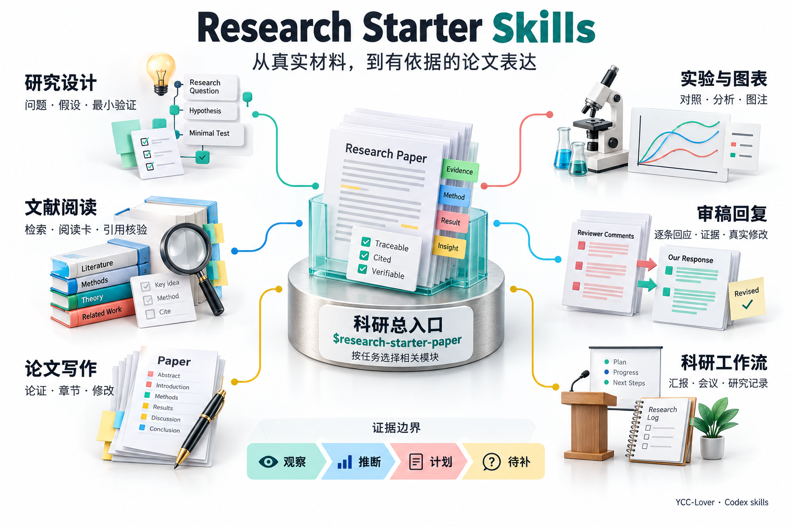

# Research Starter Skills

[中文](README.md) · [English](README_EN.md) · [版本记录](CHANGELOG.md)

**把科研方法，变成你手里能继续推进的成果。**

刚进课题组，想系统补上科研入门？导师指导有限，正在自己摸索？从找论文、读论文，到选题、写作、返修和学术交流，Research Starter Skills 把科研方法组织成 Codex 可以按任务使用的 **1 个总入口 + 6 个专业模块**，陪你从当前卡住的一步开始。

先读 [Research-Starter-Kit](https://github.com/LAMDA-NeSy/Research-Starter-Kit) 的原创教程理解方法，再用本项目的 skills 处理自己的文献、笔记、数据和草稿：把阅读变成观点，把结果变成论证，把问题变成下一步。

**[下载最新版](https://github.com/YCC-Lover/research-starter-skills/releases/latest) · [开始安装](#三步开始) · [新手学习路径](docs/LEARNING_PATH.md) · [看完整任务](examples/worked/README.md) · [看对照实测](evals/utility/REPORT.md)**

**来源与致谢：** 科研方法源自 [LAMDA-NeSy/Research-Starter-Kit](https://github.com/LAMDA-NeSy/Research-Starter-Kit) 的全部 19 篇教程。感谢郭兰哲老师及陈煜旸、葛凌岳、张逸凯等同学的整理与分享；YCC-Lover 负责独立提炼、Codex 适配与扩展维护。[逐篇来源](skills/research-starter-paper/references/sources.md) · [归属与使用范围](NOTICE.md)

产品概念图由本项目使用 GPT-image 生成。[图像说明](docs/images/workflow-product.prompt.md) · [更多场景](examples/SHOWCASE.md)

## 用一次具体任务，感受它的价值

| 你手里有什么 | skill 帮你推进什么 | 你会拿到什么 |
| --- | --- | --- |
| 一个宽泛方向、有限时间和设备 | 比较候选问题，找到最有信息价值的验证 | 近期优先建议、研究问题、最小验证计划 |
| 几篇论文和零散阅读笔记 | 比较路线、条件与分歧，形成自己的观点 | 证据综合、可追溯索引、具体研究切口 |
| 一段引言或学位论文章节 | 重建论证，统一术语、数据版本和跨章关系 | 可替换正文、实质修改说明、联动清单 |
| 实验表格、TG/DTG 或表征结果 | 看清关键比较与指标权衡，组织图文表达 | 图方案、图注、结果与讨论、后续验证 |
| 多条审稿意见和修订记录 | 确定返修优先级，把回复对应到实际改稿 | 回复草稿、证据与位置联动表、行动顺序 |
| 开题、组会或答辩准备 | 一问一答地练习，针对你的原话反馈 | 更清楚的研究表达、改述练习、下一问 |

小任务直接给成果，复杂任务先理清材料；学习时讲方法、做练习，执行时处理文本和文件，检查时给出发现与建议。你可以随时切换，按自己的进度推进。

## 三步开始

### 1. 安装七个技能

在 [最新发布页](https://github.com/YCC-Lover/research-starter-skills/releases/latest) 下载 Assets 中的 `research-starter-skills-v<版本>.zip`，解压后在含 `catalog.json` 的目录运行：

~~~text
python scripts/install_skills.py
~~~

也可以使用 Git：

~~~text
git clone https://github.com/YCC-Lover/research-starter-skills.git
cd research-starter-skills
python scripts/install_skills.py
~~~

安装使用 Python 3.10+ 和标准库。技能默认放在 `$CODEX_HOME/skills`，未设置时放在 `~/.codex/skills`。七个目录保持同级，便于总入口协调各模块。[安装、更新与备份](docs/INSTALLATION.md)

### 2. 带上当前材料

新开 Codex 对话，附上一段草稿、一份记录或几篇论文。还没有适合分享的材料，可以先用 [首次引言练习](examples/first-run/README.md) 或 [七套教学任务](examples/worked/README.md)。

### 3. 说出你想完成的事

~~~text
使用 $research-starter-paper。
我是材料方向硕士生，正在比较两种处理的热行为，材料见附件。
请先给我本周值得优先推进的问题和最小验证计划。
~~~

~~~text
使用 $rsk-paper-writing。
请修改附件中的3.4讨论，先给可替换正文，
再列出需要联动修改的位置和关键依据。
~~~

~~~text
使用 $rsk-research-workflow，陪我练习开题问答。
根据我的回答给简短反馈，再追问一个问题。
~~~

已明确任务时可以直接点名小模块；希望先梳理方向时交给总入口。[19 个可直接改用的提示词](examples/README.md)

## 从自学到写作

**从方法走到实践。** 学习路径把原教程、具体任务、练习产出与自查连在一起。刚入门时，可以从对象、现象和可用资源开始；已有结果时，可以直接进入写作与分析。

**把零散材料连成论证。** 文献综合关注路线之间的关系，长文修改关注章节之间的依赖，返修关注意见、证据和稿件之间的对应。交付围绕你当前需要使用的成果展开。

**让下一步更明确。** 候选问题比较会解释取舍；实验建议会说明新增信息的价值；学习反馈会回到你的原句，并给一个可以完成的练习。

**持续积累自己的研究记录。** 可复用现有项目笔记或 [接续模板](skills/research-starter-paper/assets/project-state.md)，换对话时从当前文件和真实进展继续。[按阶段学习](docs/LEARNING_PATH.md)

## 总入口与六个模块

| Skill | 适合的任务 |
| --- | --- |
| [research-starter-paper](skills/research-starter-paper/SKILL.md) | 科研入门、跨阶段协作、材料梳理与接续 |
| [rsk-research-design](skills/rsk-research-design/SKILL.md) | 选题、候选问题比较、Idea、最小验证 |
| [rsk-literature](skills/rsk-literature/SKILL.md) | 检索、批判阅读、多文献综合、引用版本 |
| [rsk-paper-writing](skills/rsk-paper-writing/SKILL.md) | 引言、摘要、方法、结果讨论、学位论文一致性 |
| [rsk-experiments-figures](skills/rsk-experiments-figures/SKILL.md) | 实验比较、材料表征、图注、TG/DTG 数据检查 |
| [rsk-rebuttal](skills/rsk-rebuttal/SKILL.md) | 审稿回复、返修排序、稿件与证据联动 |
| [rsk-research-workflow](skills/rsk-research-workflow/SKILL.md) | 组会、参会交流、科研记录、开题与答辩演练 |

TG/DTG 模块还提供只读 CSV 检查与按实际温度网格计算导数的工具；`--derive` 使用环境中已有的 NumPy。[完整热分析任务](skills/rsk-experiments-figures/references/thermal-task.md)

## 看成果，也看对照

[完整教学任务](examples/worked/README.md)提供输入、提示词和纠错练习；[实用价值对照](evals/utility/REPORT.md)比较相同材料下直接使用 Codex 与加载 skill 的实际答复。

本轮采用六类复杂任务、每类两次独立重复，并从研究推进、证据整合、交付可用、行动决策和协作效率五个维度评价。你可以直接阅读两组答案，找到与自己最接近的场景。[实验协议](evals/utility/PROTOCOL.md) · [历史评测](evals/README.md) · [工程验收](docs/PROJECT_AUDIT.md)

本轮两组均分均为14.96/15，十二对整体接近。文献综合中的判别设计、章节修改的联动清单、针对原话的学习反馈，都有完整实例可看；选择你需要的工作方式，比单看一个总分更有用。

## 自己使用，也可以继续改进

技能是可读、可编辑的 Markdown 文件。同机同一用户目录可由不同 Codex 账号继续使用；换机器或用户目录后重新安装即可。公开仓库可以 clone 或 fork，修改后通过自己的 GitHub 权限推送或提交 Pull Request。[协作说明](AGENTS.md)

已安装用户可先运行 `python scripts/install_skills.py --check` 查看版本与文件状态，再使用显式备份更新：

~~~text
python scripts/install_skills.py --update --backup-dir D:\Codex\work\research-starter-skills-backups
~~~

安装器保存版本和文件哈希；`--doctor` 提供只读环境诊断。数据解析、作图和 Word/PDF/LaTeX 交付按当前 Codex 环境中的工具完成。[详细验收](docs/INSTALLATION.md#安装后验收)

当前版本为 **v1.4.0**，来源固定于上游提交 `36ba390d153f5289308ec833e2b633c26b304a7b`。原教程归属、独立补充与发布范围见 [NOTICE.md](NOTICE.md)，引用信息见 [CITATION.cff](CITATION.cff)。

## 一起让科研起步更容易

从你正在卡住的一段文字、一张图或一次汇报开始，完成一个任务，再逐步拓展自己的科研方法。

觉得有帮助，欢迎 Star 收藏；也欢迎通过 [Issues](https://github.com/YCC-Lover/research-starter-skills/issues) 分享脱敏后的具体问题，通过 Pull Request 补充真实可复核的场景。[贡献指南](CONTRIBUTING.md)
