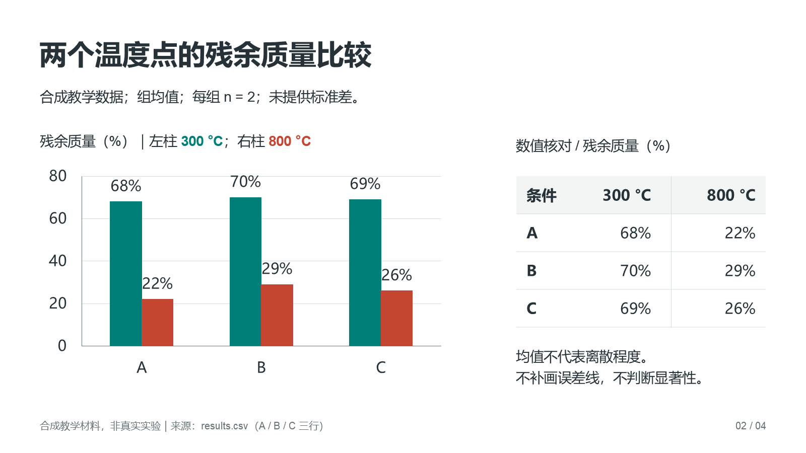
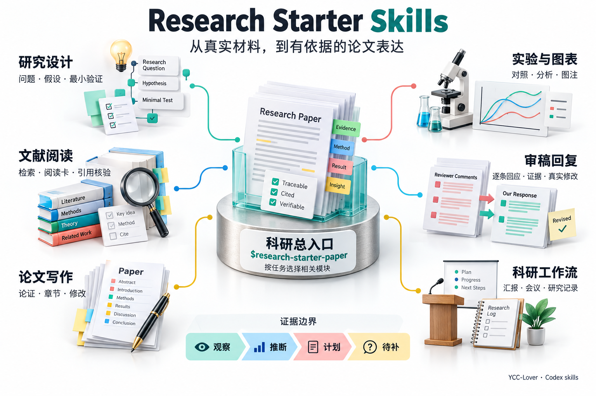

# Research Starter Skills

**Research training, academic writing and presentations, connected to your own project.**

 

New to research, missing systematic training, or working without regular guidance? Start with your supervisor's suggestion, one note, or a draft. **One router and six focused Codex skills** help you identify a manageable next step and produce something you can use.

Read the relevant original tutorial in [Research-Starter-Kit](https://github.com/LAMDA-NeSy/Research-Starter-Kit) to understand the method, then apply it to your own materials. Work across questions, literature, writing, revision, editable presentations and academic communication as needed. Detailed guides are primarily in Chinese; specify your discipline and preferred output language.

**[Get started](#quick-start) · [Download](https://github.com/YCC-Lover/research-starter-skills/releases/latest) · [Inspect an actual deliverable](#deliverables) · [Documentation](docs/README.md) · [中文](README.md)**

The research methods originate in 19 upstream tutorials. YCC-Lover independently distills, adapts and extends this bundle. [Sources and thanks](#credits)

## Start Where You Are Stuck

| Your situation | A useful next deliverable |
| --- | --- |
| A broad direction, no clear starting point | A question card, minimal material request and next action |
| Several papers, no coherent point of view | Method comparisons, evidence relationships and a grounded synthesis |
| Results or a rough chapter | Replacement prose, natural editing, voice matching and linked chapter changes |
| Revision, presentation or defense preparation | Evidence-backed replies, editable PPTX, speaker notes and focused rehearsal |

An incomplete plan is enough to start. A narrow editing request stays narrow; review-only requests do not automatically modify files.

## Start in Three Steps

### 1. Install the Seven Skills

Download `research-starter-skills-v<version>.zip` from the Assets on the [latest release](https://github.com/YCC-Lover/research-starter-skills/releases/latest), extract it, and run beside `catalog.json`:

~~~text
python scripts/install_skills.py
~~~

Installation requires Python 3.10+ and the standard library. The seven directories install together under `$CODEX_HOME/skills`, or `~/.codex/skills` by default. Ordinary text guidance does not require plotting, presentation or voice dependencies.

Install with Git, or update an existing installation

~~~text
git clone https://github.com/YCC-Lover/research-starter-skills.git
cd research-starter-skills
python scripts/install_skills.py
~~~

Check existing content and preserve your customizations before an explicit backup update:

~~~text
python scripts/install_skills.py --check
python scripts/install_skills.py --update --backup-dir <backup-directory>
~~~

Keep the backup directory separate from the source and installation. [Installation and checks](docs/INSTALLATION.md)

### 2. Open a New Chat With One Item

Bring a paragraph, a note, a paper or a readable data export. With no file, describe your direction in everyday words. You do not need an expert prompt or a complete proposal. [Beginner guide](docs/BEGINNER.md)

### 3. Ask for a Usable Result

~~~text
Use $research-starter-paper.
I have not had systematic research training.
My supervisor mentioned [direction].
Help me prepare something for our next meeting.
Save progress in my authorized project folder: [path].
~~~

Have a draft, presentation or defense task? Start directly

**Writing and natural editing**

~~~text
Use $rsk-paper-writing to revise this discussion.
Give replacement prose first. Keep the numbers,
citations, meaning and my voice; then list key
changes and chapters that also need updating.
~~~

**Editable research presentations**

~~~text
Use $rsk-research-workflow to create an eight-minute
meeting deck from the supplied notes and data.
Keep charts editable, add speaker notes, state
evidence limits and inspect the exported file.
~~~

**Proposal defense rehearsal**

~~~text
Use $rsk-research-workflow. Ask one question about
my proposal, wait for my answer, give focused
feedback, and then continue.
~~~

[19 adaptable prompts](examples/README.md) · [Seven complete teaching tasks](examples/worked/README.md) · [Original-tutorial learning path](docs/LEARNING_PATH.md)

## Inspect an Actual Deliverable

This is an actual PowerPoint render from the four-slide v2.1.0 synthetic teaching deck. Download the PPTX to inspect native chart data, tables, formulas and speaker notes.

**[Download the editable example](https://github.com/YCC-Lover/research-starter-skills/releases/download/v2.1.0/research-presentation-demo-v2.1.0.pptx) · [Inputs and exercise](examples/research-presentation/README.md) · [Actual checks](evals/presentations-v21/REPORT.md)**

The file contains a native Chart, Table, embedded workbook, OMML formula and four note pages. A separate cover-only edit preserved 15 untouched slide/master/layout/note parts byte-for-byte. The inputs are synthetic teaching materials, not real research findings. [Preview provenance](docs/images/presentation-native.source.md)

## One Router, Six Focused Modules

- **[Research router](skills/research-starter-paper/SKILL.md)**: beginner guidance, cross-stage work, materials and handoff.
- **[Research design](skills/rsk-research-design/SKILL.md)**: questions, candidate comparisons, ideas and minimum tests.
- **[Literature](skills/rsk-literature/SKILL.md)**: search, critical reading, synthesis and citation versions.
- **[Paper writing](skills/rsk-paper-writing/SKILL.md)**: arguments, thesis consistency, natural editing and author voice.
- **[Experiments and figures](skills/rsk-experiments-figures/SKILL.md)**: fair comparisons, characterization, captions and TG/DTG checks.
- **[Reviewer replies](skills/rsk-rebuttal/SKILL.md)**: point-by-point replies, priorities and revision evidence.
- **[Research workflow](skills/rsk-research-workflow/SKILL.md)**: editable decks, template editing, meetings and rehearsal.

View the router and module concept map

Generated with GPT-image. This is conceptual artwork, not a software interface or research data. [Generation notes](docs/images/workflow-product.prompt.md) · [More examples](examples/SHOWCASE.md)

## Learn, Write and Continue

**Methods connected to practice.** The [learning path](docs/LEARNING_PATH.md) connects upstream tutorials to tasks, practice and self-checks. Learn alongside the work, or start directly with your materials.

**Natural prose, still your voice.** Author samples, structural editing and 26 expression checks help reduce repetition and formulaic wording while preserving numbers, citations, formulas, uncertainty and technical meaning. No detector-evasion promise.

**Progress you can inspect.** Guided tasks save confirmed information, actual files and the next step in your authorized project. A fresh chat checks the records and material changes before continuing. Review-only tasks, short prose edits and requests not to save do not force project tracking. This is not background monitoring or automatic memory across unrelated chats. [Saving and resuming](docs/BEGINNER.md)

## Advanced Research Workflows

The seven entries connect **35 advanced modes**, including systematic reviews, complete manuscript work, multi-perspective review and multi-stage handoffs. Everyday tasks can use only the relevant guidance.

Capabilities and execution conditions

| Task | Available workflow |
| --- | --- |
| Develop a research question | Socratic guidance, deep research, WHY/HOW/WHAT and fact checks |
| Conduct a systematic review | Protocols, deduplication, pilot screening, independent contexts and conflict resolution |
| Organize a manuscript | Planning, outline, sections, abstract, literature review and citation verification |
| Review and revise | Multi-perspective review, methodology checks, coaching, author decisions and re-review |
| Connect research stages | Material passports, checkpoints, evidence records, AI-use disclosure and submission checks |

Independent screening and review require actual independent contexts. Network access, conversions and external services depend on the environment. Presentation routes include generation, source-preserving editing, templates, beautification and image reconstruction. Outline and rehearsal requests do not start deck production.

[Research modes](skills/research-starter-paper/references/advanced-research.md) · [Research helpers](skills/research-starter-paper/references/runtime-helpers.md) · [Presentations](skills/rsk-research-workflow/references/presentations.md) · [Presentation dependencies and limits](skills/rsk-research-workflow/references/presentation-tools.md)

## Verification and Limits

- [Guided-task regression](evals/integration-v21/REPORT.md): eight synthetic cases; 55 of 56 checks passed and one remains unconfirmed. This is not evidence of universal efficiency or real research accuracy.
- [Presentation checks](evals/presentations-v21/REPORT.md): native objects, package structure, templates, selective edits and actual PowerPoint rendering are checked separately. External narration, video and every template class were not individually tested.
- [Engineering audit](docs/PROJECT_AUDIT.md) and the CI badge: package structure, sources, links, installation and record integrity are not scientific-validity judgments.

Use only materials you may share, and follow team requirements for sensitive or unpublished work. Keep unread material, missing evidence and unexecuted steps explicit. No universal journal compatibility, fixed time savings or publication-acceptance guarantee.

## Sources and Thanks

The methods originate in all 19 tutorials of [LAMDA-NeSy/Research-Starter-Kit](https://github.com/LAMDA-NeSy/Research-Starter-Kit). Thanks to Guo Lanzhe, Chen Yuyang, Ge Lingyue, Zhang Yikai and the other contributors. YCC-Lover independently distills, adapts, extends and maintains this repository.

Advanced research, natural-editing and presentation resources retain their pinned provenance and separate usage conditions. No new unified license has been added to the whole repository. [Tutorial sources](skills/research-starter-paper/references/sources.md) · [Attribution and usage scope](NOTICE.md) · [Citation](CITATION.cff) · [Changelog](CHANGELOG.md)

## Use It and Help Improve It

Different Codex accounts can use the same installed files in one local user profile. Reinstall on another machine. Clone or fork the public repository; write access is controlled separately by GitHub permissions.

Star to find it again, share a sanitized scenario in [Issues](https://github.com/YCC-Lover/research-starter-skills/issues), or contribute a reproducible example through a Pull Request. [Contributing](CONTRIBUTING.md)
