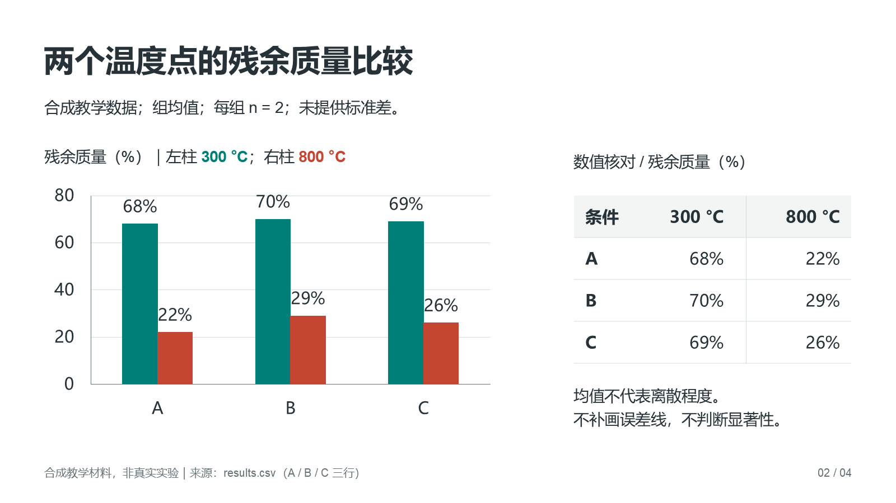

# 可编辑科研汇报练习

[项目首页](../../README.md) · [文档导航](../../docs/README.md) · [制作指南](../../skills/rsk-research-workflow/references/presentations.md)

## 先查看实际文件

[下载四页示例 PPTX](https://github.com/YCC-Lover/research-starter-skills/releases/download/v2.1.0/research-presentation-demo-v2.1.0.pptx)，
可检查原生图表、表格、嵌入工作簿、公式和逐页讲稿。下图是该文件第 2 页的实际 PowerPoint 渲染。



[数据和对象验收](../../evals/presentations-v21/REPORT.md) · [预览来源](../../docs/images/presentation-native.source.md)

## 使用相同输入复做

[材料](materials.md)和 [CSV](results.csv)均为合成教学输入，不是真实实验。

```text
使用 $rsk-research-workflow。请快速根据 materials.md 和 results.csv
生成4页课题组汇报，不需再做设计确认。
数据图、表格、公式保持原生可编辑，附逐页讲稿。
请检查导出的实际PPTX，保留证据不足和下一步计划的状态。
```

自行检查：三个条件与两个温度的数值是否完全对应；是否虚构误差线、机制或显著性；
是否实际交付了能打开的 PPTX；图表的 Edit Data 是否可用；公式与讲稿是否存在；
渲染后的页面有无裁切、重叠或字体替换。脚本通过不等于这些问题都已检查。

追加练习：保留原文件，只改封面标题；核对其他页面与母版是否保留。再把其中一种
版式创建为可复用模板，验证结构后用于另一份明确标注为合成的新内容。

制作指南见 [科研演示制作](../../skills/rsk-research-workflow/references/presentations.md)。
